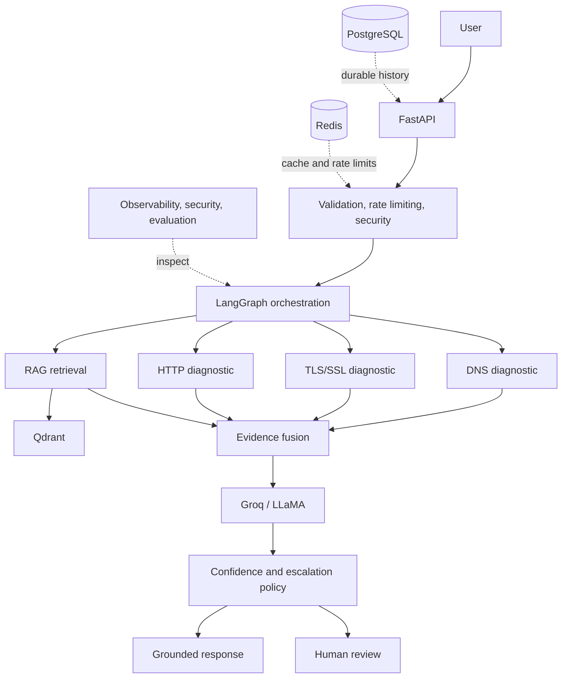
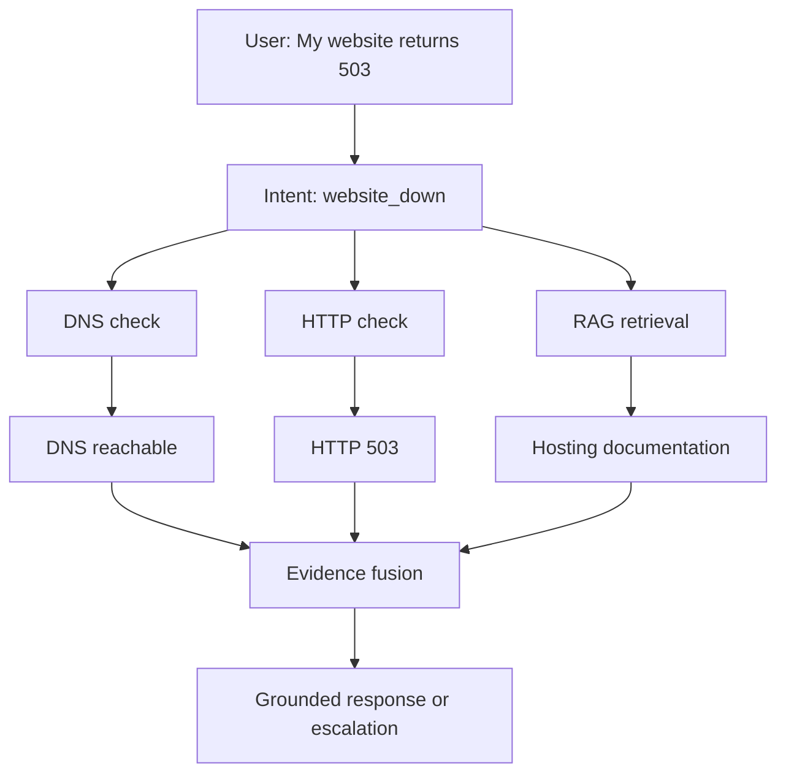

# Agentic DNS & Hosting Support Copilot

**A LangGraph-based AI support system combining RAG with read-only DNS, TLS, and HTTP diagnostics.**

[](https://github.com/Haroldojo/RAG-for-DNS-lookup/actions/workflows/ci.yml)

## Business problem

DNS, domain, SSL/TLS, hosting, and website-availability cases often require support engineers to search several documents, run separate technical checks, interpret conflicting evidence, and decide whether to escalate. This portfolio project combines that work into one inspectable, evidence-driven flow. It is not claimed to be deployed or used by any employer.

## What the system does

- Classifies a support query deterministically and runs only relevant read-only tools.
- Retrieves support evidence from Qdrant and attaches application-controlled citations.
- Runs DNS, TLS/SSL, and HTTP diagnostics without changing infrastructure.
- Fuses tool results with documentation before Groq/LLaMA generates an answer.
- Persists durable history and escalates uncertain, conflicting, blocked, or failed diagnoses for human review.

## Architecture



The LLM does **not** control infrastructure. It receives structured evidence and produces an explanation; deterministic policy, application-controlled citations, and human review remain outside the model.

### Example request flow: website returns 503



More detail: [architecture documentation](docs/architecture.md).

## Key engineering features

| Area | Implementation |
| --- | --- |
| Orchestration | Deterministic LangGraph routing with inspectable state and dependency-aware skips |
| RAG | Qdrant vector search, FastEmbed/BGE embeddings, source metadata, controlled citations |
| Diagnostics | Read-only DNS, TLS/SSL, and HTTP checks with structured failure types |
| Evidence | Evidence fusion before LLM generation; the model does not create technical facts |
| Persistence | PostgreSQL, SQLAlchemy 2.x, Alembic migrations, durable conversation history |
| Cache and limits | Redis cache-aside and fixed-window rate limiting |
| Safety | Prompt-injection handling, SSRF defenses, PII/secret redaction, tenant-scoped retrieval |
| Operations | Structured logs, traces, metrics, readiness/liveness, Docker Compose, Nginx |
| Quality | Offline evaluation, regression gates, red-team testing, Ruff, Pytest, GitHub Actions CI |

## Measured results

These are local/offline evaluation results, not production-traffic claims.

- **100-scenario offline evaluation suite**
- **Routing accuracy:** improved from **71% to 97%** after a small deterministic classifier refinement
- **Tool-selection accuracy:** **97%**
- **Escalation precision and recall:** **100%** on the controlled corpus
- **107 automated tests passing**
- **56-scenario controlled offline security/red-team suite** with all defined gates passing
- **GitHub Actions CI:** passing (externally verified for the published Phase 13 commit)

Evaluation reports: [Markdown](data/evaluation/reports/phase11_report.md), [JSON summary](data/evaluation/reports/phase11_summary.json), [CSV](data/evaluation/reports/phase11_results.csv), and [security results](data/evaluation/reports/phase12_security.json).

## Safety and reliability by design

- Deterministic routing rather than an LLM deciding which diagnostic tool to run.
- Read-only DNS, TLS, and HTTP tools; no infrastructure mutations exist in this project.
- Direct prompt-injection detection and sanitization of untrusted retrieved documents.
- SSRF blocks loopback, private, link-local, metadata, and unsupported-scheme targets; redirects are revalidated.
- Secret/PII redaction, output screening, tenant-aware retrieval, and explicit read-only tool permissions.
- Redis/observability failures fail open when safe; security controls fail closed; durable persistence fails closed.
- Low confidence, conflicting evidence, tool failures, and unknown issues trigger human-review escalation.

These controls were tested with a **56-scenario controlled offline red-team benchmark**. They do not constitute production security certification. See [security notes](docs/security.md).

## Engineering decisions

- **Deterministic routing:** predictable, testable initial intent selection is safer than model-only routing.
- **Evidence before generation:** the LLM interprets retrieved/tool evidence; it does not invent DNS, TLS, HTTP, ownership, configuration, or citations.
- **PostgreSQL:** durable relational history, transactions, and audit relationships.
- **Redis:** disposable short-lived caching and rate limits, never durable conversation history.
- **Qdrant:** vector embeddings and metadata-filtered semantic retrieval.
- **Human review:** a clear safety boundary for uncertainty and any future write-capable tool.

## Tech stack

| Category | Technology |
| --- | --- |
| Backend | Python, FastAPI, Pydantic |
| Agent workflow | LangGraph |
| LLM | Groq / LLaMA through a provider abstraction |
| RAG | Qdrant, FastEmbed, BAAI `bge-small-en-v1.5` |
| Database | PostgreSQL, SQLAlchemy 2.x, Alembic |
| Cache | Redis |
| Diagnostics | DNS, TLS/SSL, HTTP |
| Testing and quality | Pytest, Ruff |
| Containers and proxy | Docker, Docker Compose, Nginx |
| CI | GitHub Actions |
| Cloud target | AWS EC2 — prepared, **not deployed** |

## Demo

After starting the stack, open `http://localhost/docs` and try:

```json
POST /api/v1/diagnose
{
  "query": "My website returns 503 after a hosting migration",
  "domain": "example.com"
}
```

The response exposes intent, route, tools called/skipped, DNS/SSL/HTTP evidence, retrieved chunks, citations, confidence, escalation state, and errors. See the [demo and screenshot guide](docs/portfolio.md).

## How it works

1. Validate and classify the request.
2. Run only the diagnostics required by the intent; skip dependent checks when DNS blocks them.
3. Retrieve relevant support chunks from the `support_docs` Qdrant collection.
4. Combine facts into structured evidence.
5. Generate a grounded explanation with application-controlled citations.
6. Apply deterministic escalation policy and persist compact audit history.

## Running locally

Prerequisite: Docker Engine with the Compose plugin.

```bash
git clone https://github.com/Haroldojo/RAG-for-DNS-lookup.git
cd RAG-for-DNS-lookup
cp .env.example .env
# Edit .env: use strong local passwords and add GROQ_API_KEY only if you want live LLM generation.
docker compose up -d postgres redis qdrant
docker compose run --rm app alembic upgrade head
docker compose run --rm app python -m app.rag.bootstrap
docker compose up -d app nginx
```

Open `http://localhost/docs`. For deployment ordering, migration safety, rollback, and restart guidance, read the [deployment guide](docs/deployment.md).

## Evaluation and testing

```bash
python -m pytest -q
python -m ruff format --check .
python -m ruff check .
python -m app.evaluation.run_full_evaluation
python -m app.evaluation.run_security_evaluation
```

The fixed 100-scenario corpus tests routing, tool selection, retrieval, escalation, grounding checks, and controlled failure behavior. The security suite tests prompt injection, secret exfiltration, SSRF, tenant isolation, and unsupported tool use. These scripts return a non-zero exit code when measured regression gates fail.

## Repository guide

- [Architecture](docs/architecture.md)
- [Deployment runbook](docs/deployment.md)
- [Security assumptions and benchmark scope](docs/security.md)
- [Recruiter/demo/interview guide](docs/portfolio.md)
- [Evaluation reports](data/evaluation/reports)
- [Synthetic support-document corpus](data/support_docs)

## Known limitations

- The support corpus currently contains five small synthetic/public documents. Retrieval quality is therefore the main limitation: dense **Precision@1 = 39%**, and the alternate chunking comparison reached **43%**. These are intentionally documented as limitations, not headline achievements.
- Evaluation is controlled and mostly mocked for external dependencies; there is no production user traffic.
- No authentication/identity layer exists yet, although tenant/document scope filters are designed and tested.
- Diagnostic tools are intentionally read-only.
- AWS EC2 configuration is prepared but has not been deployed or verified.

## Future improvements

- Expand and curate the support corpus.
- Compare stronger embeddings, reranking, hybrid retrieval, and chunking strategies.
- Add authenticated tenancy and production deployment validation.
- Add only reviewed, approval-gated write actions if a future product truly requires them.
